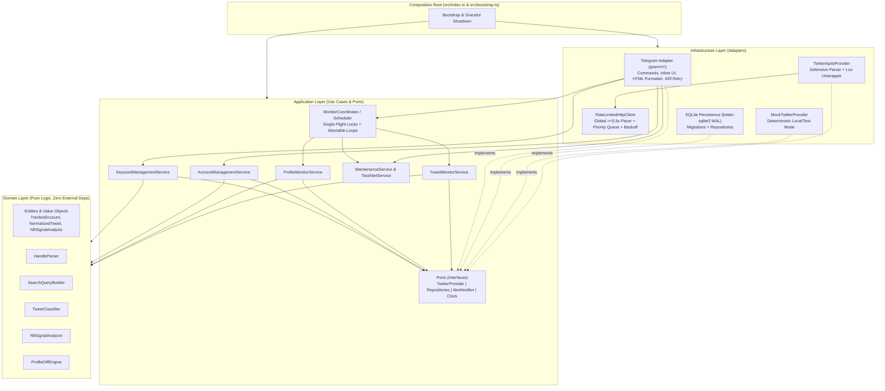
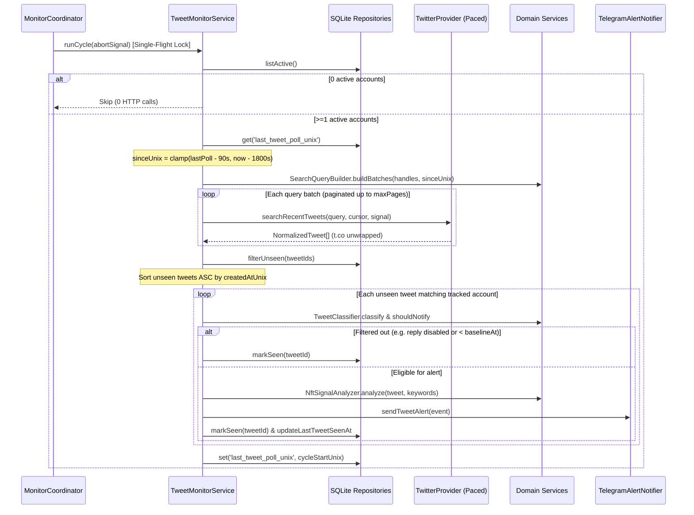

# X (Twitter) NFT Account Monitor & Telegram Alert Service — System Architecture

## 1. Executive Summary & Design Goals

This service monitors curated X (Twitter) accounts (NFT founders, collections, launchpads, alpha callers) in near real-time and delivers actionable, Russian-language alerts to authorized Telegram administrators via `grammY`.

### Core Architectural Goals
1. **Strict Hexagonal Architecture (Ports & Adapters)**:
   - **Domain Layer (`src/domain/`)**: 100% pure TypeScript with zero runtime/infrastructure dependencies. Encapsulates handle parsing, search query chunking, tweet classification, NFT signal scoring/extraction, and profile `"было → стало"` diffing.
   - **Application Layer (`src/application/`)**: Orchestrates polling cycles, account lifecycle, keyword management, and database maintenance purely through TypeScript port interfaces injected via constructors.
   - **Infrastructure Layer (`src/infrastructure/`)**: Concrete adapters for `TwitterAPI.io` (with global rate-limit pacing), `MockTwitterProvider` (`MOCK_MODE=true`), `better-sqlite3` (`WAL` mode), and `grammY` (Telegram HTML formatting, inline keyboards, flood-control retry).
2. **Cost & Rate-Limit Engineering (`TwitterAPI.io` Free/Starter Tier Safe)**:
   - Respects the `0.2 QPS` (1 request / 5 seconds) limit via a single shared **Priority Rate-Limited Request Queue** (`TWITTER_MIN_INTERVAL_MS=5500` default).
   - Batches tweet queries (`(from:h1 OR from:h2 ...) since_time:<unix>`) bounded by both handle count (`<= 20`) and query character length (`<= 450` chars, safely under X's 512-char operator limit).
   - Batches profile checks via `GET /twitter/user/batch_info_by_ids` (up to 50 IDs/call).
   - Spends **0 API requests / 0 credits** when no active accounts are tracked.
3. **Zero Missed Events & Zero Duplicate Alerts**:
   - Combines a sliding `since_time` overlap buffer (`lastPollUnix - 90s`) with idempotent SQLite `seen_tweets` primary-key deduplication and a cold-start/downtime lookback cap (`MAX_LOOKBACK_SEC=1800`).
   - Tracks accounts by immutable numeric X `userId` so `@handle` rebrands/renames are detected as high-signal profile events without losing tracking continuity.
4. **Long-Running Production Resilience**:
   - Single-flight locks prevent overlapping poll cycles.
   - `AbortController`-aware loops guarantee clean shutdown on `SIGINT`/`SIGTERM`.
   - Throttled admin notifications on `401`/`402` (out of credits)/`403` keep the daemon alive without log/alert storms.
   - Periodic SQLite pruning prevents unbounded `seen_tweets` growth over months of uptime.

---

## 2. Layered Architecture & Dependency Graph



### Dependency Rule Enforcement
- **`src/domain/**`** MUST NOT import anything from `src/application/**`, `src/infrastructure/**`, `src/config/**`, or third-party I/O packages (`grammy`, `better-sqlite3`, `pino`).
- **`src/application/**`** MUST ONLY import from `src/domain/**` and standard TypeScript types (plus structured logger interface).
- **`src/infrastructure/**`** implements ports defined in `src/application/ports/**`.
- **`src/bootstrap.ts` & `src/index.ts`** act as the sole Composition Root wiring concrete adapters into application services via constructor Dependency Injection.

---

## 3. Directory Structure

```text
/Users/alekseev/code/x/
├── docs/
│   └── ARCHITECTURE.md
├── src/
│   ├── index.ts                              # Process entrypoint & signal handlers (SIGINT/SIGTERM)
│   ├── bootstrap.ts                          # Composition root (DI wiring & lifecycle startup/shutdown)
│   ├── config/
│   │   └── env.ts                            # Zod-validated environment configuration
│   ├── domain/
│   │   ├── entities/
│   │   │   ├── account.ts                    # TrackedAccount, TwitterUserProfile, Availability
│   │   │   ├── tweet.ts                      # NormalizedTweet, ReferencedTweet, TweetKind
│   │   │   ├── signal.ts                     # NftSignalAnalysis, AlertPriority, CategorizedLink
│   │   │   ├── profile-diff.ts               # ProfileFieldChange, ProfileDiffResult
│   │   │   └── alerts.ts                     # TweetAlertEvent, ProfileAlertEvent, SystemAlertEvent
│   │   └── services/
│   │       ├── handle-parser.ts              # @handle & x.com/twitter.com URL parser/validator
│   │       ├── search-query-builder.ts       # Dual-constraint batcher (max handles + <=450 chars)
│   │       ├── tweet-classifier.ts           # POST | QUOTE | RETWEET | REPLY + reply/baseline filter
│   │       ├── nft-signal-analyzer.ts        # Trigger keywords, EVM 0x addresses, Web3 URLs, priority
│   │       └── profile-diff-engine.ts        # "Было → стало" diff across bio/url/name/handle/media/state
│   ├── application/
│   │   ├── ports/
│   │   │   ├── twitter-provider.ts           # TwitterProvider interface & DTOs
│   │   │   ├── repositories.ts               # Account, SeenTweet, Keyword, SyncState repositories
│   │   │   ├── alert-notifier.ts             # AlertNotifier interface
│   │   │   ├── logger.ts                     # Minimal Logger port interface
│   │   │   └── clock.ts                      # Clock interface + SystemClock
│   │   └── services/
│   │       ├── account-management-service.ts # Add/remove/list/toggle accounts safely
│   │       ├── keyword-management-service.ts # List/add/delete/seed trigger keywords
│   │       ├── tweet-monitor-service.ts      # Batched tweet polling, dedup, classification, alerting
│   │       ├── profile-monitor-service.ts    # Batched profile polling, handle rename & diff alerting
│   │       ├── maintenance-service.ts        # Periodic SQLite seen_tweets pruning & optimize
│   │       ├── test-alert-service.ts         # Simulated NFT mint + profile change alert generator
│   │       └── monitor-coordinator.ts        # Single-flight locks, abortable schedulers, status snapshot
│   └── infrastructure/
│       ├── logging/
│       │   └── pino-logger.ts                # Pino adapter implementing Logger port
│       ├── twitter/
│       │   ├── errors.ts                     # Typed HTTP, RateLimit, AuthOrQuota errors
│       │   ├── rate-limited-http-client.ts   # Priority FIFO pacer (>=5.5s), timeout, backoff+jitter
│       │   ├── payload-normalizer.ts         # Defensive TwitterAPI.io JSON -> Domain DTOs + t.co unwrap
│       │   ├── twitter-api-io-provider.ts    # Live TwitterAPI.io adapter
│       │   └── mock-twitter-provider.ts      # Stateful Mock adapter for MOCK_MODE=true
│       ├── persistence/
│       │   ├── sqlite-database.ts            # better-sqlite3 connection (WAL, busy_timeout, foreign_keys)
│       │   ├── migrations.ts                 # Idempotent versioned schema migrations
│       │   ├── sqlite-account-repository.ts
│       │   ├── sqlite-seen-tweet-repository.ts
│       │   ├── sqlite-keyword-repository.ts
│       │   └── sqlite-sync-state-repository.ts
│       └── telegram/
│           ├── html-escape.ts                # Strict HTML escaping & tag-safe length clamping
│           ├── telegram-formatter.ts         # Russian HTML formatting for alerts, /list, /status
│           ├── retry-transformer.ts          # grammY API transformer handling 429 retry_after
│           ├── telegram-alert-notifier.ts    # Multi-admin AlertNotifier implementation
│           └── telegram-bot.ts               # Auth middleware, Russian commands, plain @handle, callbacks
├── tests/
│   ├── domain/
│   │   ├── handle-parser.test.ts
│   │   ├── search-query-builder.test.ts
│   │   ├── tweet-classifier.test.ts
│   │   ├── nft-signal-analyzer.test.ts
│   │   └── profile-diff-engine.test.ts
│   ├── infrastructure/
│   │   ├── rate-limited-http-client.test.ts
│   │   ├── payload-normalizer.test.ts
│   │   ├── sqlite-repositories.test.ts
│   │   └── telegram-formatter.test.ts
│   └── application/
│       └── monitor-workflows.test.ts
├── Dockerfile
├── docker-compose.yml
├── .dockerignore
├── .gitignore
├── .env.example
├── package.json
├── tsconfig.json
├── vitest.config.ts
└── README.md
```

---

## 4. Domain Model & Pure Business Rules

### 4.1 Handle & URL Parsing (`HandleParser`)
- Accepts inputs: `@boredapeyc`, `boredapeyc`, `https://x.com/BoredApeYC`, `https://twitter.com/BoredApeYC?s=20`, `https://x.com/BoredApeYC/status/123456`.
- Strips `@`, URL scheme/host (`x.com`, `www.x.com`, `twitter.com`, `mobile.twitter.com`), path suffix, and query parameters.
- Rejects reserved non-user routes (`home`, `explore`, `search`, `settings`, `i`, `intent`, `share`, `messages`, `notifications`, `compose`, `tos`, `privacy`).
- Validates against X's handle rule: `/^[A-Za-z0-9_]{1,15}$/`.
- Normalizes canonical lookup key to lowercase (`handle = raw.toLowerCase()`).

### 4.2 Search Query Batching (`SearchQueryBuilder`)
- Builds `TwitterAPI.io` `advanced_search` queries of the form:
  `(from:handle1 OR from:handle2 OR ...) since_time:<unixSeconds>`
- Enforces **dual constraints** simultaneously:
  1. `handlesInChunk <= maxHandlesPerBatch` (default `20`).
  2. `fullQueryString.length <= maxQueryLength` (default `450` chars, safely under X's 512-char search limit even with `since_time:` suffix).
- Sorts handles lexicographically prior to chunking for deterministic queries.

### 4.3 Tweet Classification & Reply Filtering (`TweetClassifier`)
- Classification precedence:
  1. `RETWEET`: `tweet.retweetedTweet !== null` or `tweet.text.startsWith('RT @')`.
  2. `REPLY`: `tweet.isReply === true` or `tweet.inReplyToTweetId !== null`.
  3. `QUOTE`: `tweet.quotedTweet !== null`.
  4. `POST`: Original standalone post.
- Notification eligibility (`shouldNotify`):
  - Must satisfy `tweet.createdAtUnix >= account.baselineAt` (prevents historical tweet floods immediately after `/add`).
  - If `kind === 'REPLY'` and `!account.includeReplies`, skip alert (still recorded in `seen_tweets` so overlap polls don't re-evaluate).

### 4.4 NFT Signal Analyzer (`NftSignalAnalyzer`)
- **Default Trigger Keywords** (seeded once on initial DB creation; customizable via `/addkw` & `/delkw`):
  `mint`, `live`, `wl`, `allowlist`, `whitelist`, `premint`, `raffle`, `claim`, `snapshot`, `presale`, `airdrop`, `reveal`
- **Unicode Word-Boundary Matching**:
  - Escapes regex metacharacters in each configured keyword and matches case-insensitively with `(?<![\p{L}\p{N}_])<keyword>(?![\p{L}\p{N}_])` (`u` flag). This guarantees `wl` matches `"WL is open!"` or `"#WL"` without false-matching `"bowl"` or `"slowly"`, and supports Cyrillic keywords added by admins.
- **EVM Smart Contract Extraction**:
  - Matches `/(?<![a-fA-F0-9xX])0x[a-fA-F0-9]{40}(?![a-fA-F0-9])/g`.
  - Deduplicates case-insensitively while **preserving original EIP-55 mixed-case checksum** for safe one-tap copying in Telegram (`<code>0x...</code>`).
- **Web3 Link Extraction & Categorization**:
  - Collects URLs from `expandedUrls` (unwrapped from X `entities.urls`) plus raw `https?://` URLs in text, excluding self X status/photo URLs (`x.com`, `twitter.com`, `t.co`, `pbs.twimg.com`).
  - Categorizes recognized Web3 ecosystems:
    - `discord`: `discord.gg`, `discord.com/invite`
    - `marketplace`: `opensea.io`, `pro.opensea.io`, `blur.io`, `magiceden.io`, `magiceden.us`, `tensor.trade`, `rarible.com`, `element.market`
    - `launchpad`: `manifold.xyz`, `claim.manifold.xyz`, `zora.co`, `highlight.xyz`, `foundation.app`, `scatter.art`, `mint.fun`, `sound.xyz`
    - `raffle`: `premint.xyz`, `alphabot.app`, `heymint.xyz`, `atlas3.io`, `subber.xyz`, `guild.xyz`, `galxe.com`, `zealy.io`
    - `other`: external project websites (e.g., stealth mint domains like `https://mint.project.xyz` — still surfaced as external links!).
- **Priority Scoring**:
  - `HIGH` when `evmAddresses.length > 0 || matchedKeywords.length > 0 || categorizedWeb3Links.some(l => l.category !== 'other')`.
  - `NORMAL` otherwise (general post or routine update).

### 4.5 Profile Diff Engine (`ProfileDiffEngine`)
- Compares stored `TrackedAccount` snapshot against fresh `TwitterUserProfile`:
  - `handle`: case-insensitive or exact handle change (`@oldhandle → @newhandle`) — **always elevates priority to `HIGH`** because handle changes strongly correlate with rebrands, stealth launches, or account compromises.
  - `displayName`: trimmed string comparison.
  - `bio`: normalized newline (`\r\n` → `\n`) + trimmed comparison.
  - `websiteUrl`: normalized URL comparison (`null` vs string).
  - `avatarUrl`: compares normalized canonical avatar URL (upgrading `_normal.` / `_bigger.` to `_400x400.` and stripping volatile query strings so CDN size suffixes don't cause false positives).
  - `bannerUrl`: normalized URL comparison.
  - `availability`: transitions between `'available'` and `'unavailable'` (suspended/protected/missing).
- Runs `NftSignalAnalyzer` on updated `bio`, `websiteUrl`, and `displayName`:
  - Elevates profile alert to `HIGH` if handle changed, website URL changed/added, or `NftSignalAnalyzer` detects NFT keywords, EVM contracts, or Web3 links in the new profile fields.

---

## 5. SQLite Persistence Schema (`better-sqlite3`)

Configured on startup with:
```sql
PRAGMA journal_mode = WAL;
PRAGMA synchronous = NORMAL;
PRAGMA foreign_keys = ON;
PRAGMA busy_timeout = 5000;
PRAGMA temp_store = MEMORY;
```

### Tables (`Migration 001_initial`)

```sql
CREATE TABLE IF NOT EXISTS schema_migrations (
  version INTEGER PRIMARY KEY,
  applied_at INTEGER NOT NULL
);

CREATE TABLE IF NOT EXISTS tracked_accounts (
  user_id TEXT PRIMARY KEY,
  handle TEXT NOT NULL,
  display_name TEXT NOT NULL DEFAULT '',
  bio TEXT NOT NULL DEFAULT '',
  website_url TEXT,
  avatar_url TEXT,
  banner_url TEXT,
  include_replies INTEGER NOT NULL DEFAULT 0,
  enabled INTEGER NOT NULL DEFAULT 1,
  availability TEXT NOT NULL DEFAULT 'available',
  unavailable_reason TEXT,
  consecutive_misses INTEGER NOT NULL DEFAULT 0,
  baseline_at INTEGER NOT NULL,
  last_tweet_seen_at INTEGER,
  last_profile_checked_at INTEGER,
  created_at INTEGER NOT NULL,
  updated_at INTEGER NOT NULL
);

CREATE INDEX IF NOT EXISTS idx_tracked_accounts_handle
  ON tracked_accounts(handle COLLATE NOCASE);

CREATE INDEX IF NOT EXISTS idx_tracked_accounts_enabled
  ON tracked_accounts(enabled);

CREATE TABLE IF NOT EXISTS seen_tweets (
  tweet_id TEXT PRIMARY KEY,
  author_id TEXT NOT NULL,
  created_at_unix INTEGER NOT NULL,
  seen_at_unix INTEGER NOT NULL
);

CREATE INDEX IF NOT EXISTS idx_seen_tweets_seen_at
  ON seen_tweets(seen_at_unix);

CREATE TABLE IF NOT EXISTS trigger_keywords (
  keyword TEXT PRIMARY KEY,
  created_at INTEGER NOT NULL
);

CREATE TABLE IF NOT EXISTS sync_state (
  key TEXT PRIMARY KEY,
  value TEXT NOT NULL,
  updated_at INTEGER NOT NULL
);
```

### Key Persistence Decisions
- **Immutable `user_id` Primary Key**: If `@project_xyz` renames to `@project_token`, `batch_info_by_ids` returns the new `userName` under the same `user_id`. `ProfileMonitorService` emits a `HIGH` alert (`@project_xyz → @project_token`) and updates `tracked_accounts.handle` in place so subsequent `advanced_search` queries automatically query `from:project_token`.
- **One-Time Default Keyword Seeding**: `KeywordManagementService` checks `sync_state['defaults_seeded']`. On first run, it seeds the 12 default NFT keywords and sets `defaults_seeded = '1'`. If an admin removes a noisy default keyword via `/delkw`, it stays deleted across restarts.
- **Consecutive Miss Guard (`consecutive_misses`)**: If `batch_info_by_ids` omits a user ID without an explicit `unavailable: true` object, `ProfileMonitorService` only transitions `availability` to `'unavailable'` after 2 consecutive misses (preventing false alerts on transient partial API responses), whereas explicit `unavailable: true` transitions immediately.

---

## 6. Rate-Limiting, Polling Math & Error Recovery

### 6.1 Global Priority Rate-Limited Pacer (`RateLimitedHttpClient`)
- **Constraint**: `TwitterAPI.io` unpaid starter plan enforces `0.2 QPS` (1 request / 5,000ms).
- **Implementation**:
  - Maintains two internal FIFO queues: `highQueue` (interactive `/add` lookups) and `normalQueue` (scheduled tweet/profile batch polls), drained by a single serialized worker loop.
  - Enforces `now - lastRequestStartedAt >= minIntervalMs` (`5500ms` default = `0.181 QPS`).
  - Uses `AbortSignal.any([callerSignal, AbortSignal.timeout(httpTimeoutMs)])` on every `fetch`.
- **Retry & Error Policy**:
  - `429 Too Many Requests` / `500, 502, 503, 504` / transient network error:
    - Honors `Retry-After` header if present; else computes exponential backoff with full jitter (`baseMs * 2^attempt + jitter`, e.g., `6s`, `12s`, `24s`), advancing the global cooldown window so queued items wait cleanly.
  - `401 Unauthorized` / `402 Payment Required` / `403 Forbidden`:
    - Fails immediately without retry (`TwitterProviderAuthOrQuotaError`).
    - Invokes throttled system alert callback (max 1 alert per 30 minutes per status code) so admins receive a clear Russian warning in Telegram (e.g. `⚠️ Ошибка TwitterAPI.io (HTTP 402): недостаточно кредитов или требуется оплата тарифа`) while the service remains running and automatically recovers once credits/keys are restored.

### 6.2 Request & Credit Budget Analysis (Example: 20 Monitored Accounts)
- **Tweet Polling** (`TWEET_POLL_INTERVAL_SEC = 60`):
  - 20 handles fit in **1** `advanced_search` query (`~260` chars `<= 450`).
  - `60` req/hour (`1,440` req/day).
- **Profile Polling** (`PROFILE_POLL_INTERVAL_SEC = 180`):
  - 20 user IDs fit in **1** `batch_info_by_ids` query.
  - `20` req/hour (`480` req/day).
- **Peak Concurrency**:
  - Even when both timers fire in the same second, the global pacer serializes Request 1 at `t=0.0s` and Request 2 at `t=5.5s` — **0 collisions, 0 HTTP 429s**.

### 6.3 End-to-End Tweet Polling Sequence



---

## 7. Telegram Bot UX & Safety Specification

### 7.1 Security & Authorization
- Middleware checks `ctx.chat?.id` against `ADMIN_CHAT_IDS` (`Set<string>`).
- Unauthorized chats receive `"⛔ Доступ запрещён."` and are logged at `warn` level with `chatId` and `username` (helping an operator discover their Chat ID on initial setup).

### 7.2 Commands & Interactive Controls (Russian)
| Command / Input | Behavior |
|---|---|
| `/start`, `/help` | Welcome screen, mode (`LIVE` / `MOCK`), command reference, and quick usage examples. |
| `/add <@handle \| url>` | Validates input, checks duplicate fast-path, resolves via `getUserByHandle`, stores baseline snapshot, replies with profile card + inline buttons. |
| Plain text `@handle` or `https://x.com/...` | Automatically invokes the `/add` workflow in private/admin chat for frictionless UX. |
| `/remove <@handle \| url>` | Removes tracked account from SQLite and confirms. |
| `/list` | Paginated list of tracked accounts showing status (`🟢` active, `⏸` paused, `⚠️` unavailable), reply filter (`💬 ВКЛ/ВЫКЛ`), and per-account inline toggle/delete buttons. |
| `/keywords` | Displays all active NFT trigger keywords. |
| `/addkw <слово[, слово2]>` | Adds one or more normalized trigger keywords (supports comma separation). |
| `/delkw <слово>` | Deletes a trigger keyword. |
| `/status` | Shows uptime, mode, account counts, `seen_tweets` count, last tweet/profile sync timestamps & stats, API pacer/health metrics, and `[🔄 Проверить сейчас]` inline button. |
| `/test_alert` | Dispatches a simulated `HIGH`-priority NFT Mint tweet alert (with `0x` contract + Web3 links) AND a simulated profile `"было → стало"` alert through `AlertNotifier`. |

### 7.3 Callback Query Protocol (`<= 64` bytes strict)
- `r:<userId>:<page>` — Toggle `includeReplies` for `userId` and refresh `/list` (or card if `page` is `c`).
- `p:<userId>:<page>` — Toggle `enabled` (Pause/Resume) for `userId` and refresh view.
- `d:<userId>:<page>` — Delete account `userId` and refresh view.
- `l:<page>` — Navigate `/list` pagination page.
- `chk_now` — Trigger immediate non-overlapping tweet + profile check cycle and reply with summary.
*(Max length e.g. `r:18446744073709551615:99` = 25 bytes << 64-byte Telegram limit.)*

### 7.4 Outbound HTML Safety & Flood Control
- **Strict HTML Escaping**: Every external string (`displayName`, `handle`, `tweet.text`, `bio`, URLs in attributes/text) passes through `escapeHtml()` (`&`, `<`, `>`, `"`) **before** HTML template assembly.
- **Tag-Safe Clamping (`<= 4096` chars)**: Raw text fields (`tweet.text`, `quotedTweet.text`, `before`/`after` bios) are length-clamped *prior* to wrapping in `<b>`, `<code>`, `<blockquote>`, `<a href="...">` tags so closing HTML tags are never truncated mid-tag.
- **One-Tap Contract Copy**: EVM addresses are formatted as `<code>0x...</code>` (full 42-char checksummed address).
- **Flood Control Transformer**: Custom `grammY` API transformer intercepts HTTP `429 Too Many Requests` (`parameters.retry_after`), waits `(retry_after * 1000) + 250ms`, and retries automatically up to 3 times; disables web page link previews (`link_preview_options: { is_disabled: true }`) by default on alerts so huge media embeds don't obscure contract addresses or hit preview rate limits.

---

## 8. Lifecycle, Graceful Shutdown & Containerization

1. **Startup Sequence (`bootstrap.ts`)**:
   - Parse & validate `env.ts` via `zod`.
   - Open SQLite DB, set `WAL` & `busy_timeout`, execute versioned migrations, seed initial default keywords (if first boot), and run startup `seen_tweets` retention cleanup.
   - Instantiate `TwitterApiIoProvider` (wrapped in `RateLimitedHttpClient`) or `MockTwitterProvider` when `MOCK_MODE=true`.
   - Instantiate `TelegramBot` & `TelegramAlertNotifier`.
   - Start `MonitorCoordinator` background loops (`TweetMonitorService`, `ProfileMonitorService`, `MaintenanceService`) and `bot.start()` long-polling.
2. **Shutdown Sequence (`SIGINT` / `SIGTERM`)**:
   - Trigger root `AbortController.abort()` to wake all sleeping poll timers and cancel in-flight HTTP requests cleanly.
   - Stop `grammY` long-polling (`await bot.stop()`).
   - Await active single-flight poll promises (bounded by shutdown timeout).
   - Run `db.close()` cleanly so SQLite checkpoints `WAL` without corruption.
3. **Docker Deployment**:
   - Multi-stage `Dockerfile` (`node:22-bookworm-slim`) compiling TypeScript and native `better-sqlite3` addon in builder stage, running as non-root `node` user in production stage with `/app/data` volume mounted via `docker-compose.yml`.
